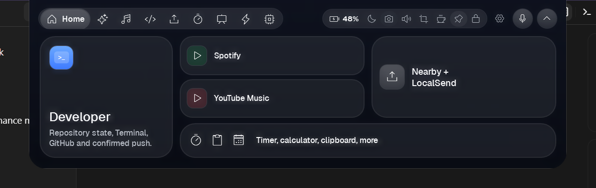
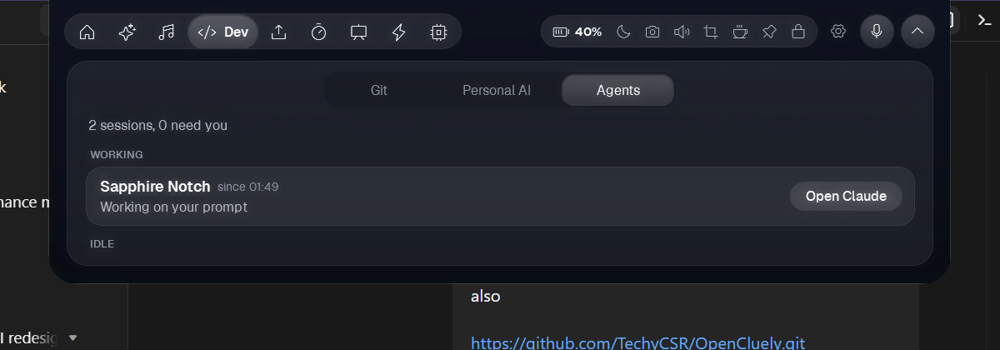

# Sapphire NOTCh

**A Dynamic Island–style command center for Windows. It sits at the top of your screen and puts AI chat, offline voice dictation, a meeting copilot, coding-agent monitoring, music, Git and system tools one hover away.**


<p align="center">
  <br>
  
</p>

---

## Key Architecture & Features

- **Spring-physics notch shell** (`Spring.cs`, `MainWindow.xaml`, `BackdropBlur.cs`, `DwmHelper.cs`): a borderless WPF window, always on top. It animates with a critically damped spring simulation. Acrylic blur and rounded corners come from DWM interop, and a built-in FPS monitor (`Fps.cs`) helps tune rendering cost.
- **Multi-provider AI chat** (`AiService.cs`, `MainWindow.Chat.cs`): connects to any OpenAI-compatible endpoint (OpenRouter by default, including free models). You can pick a role, attach images, and get optional check-in reminders every 15 minutes.
- **Offline voice dictation** (`WhisperDictation.cs`, `SpeechDictation.cs`, `VoiceTrigger.cs`): push-to-talk speech-to-text runs on the device with Whisper.net and NAudio, so no audio leaves the machine. Text is typed into whichever window is focused. Usage history is kept in `DictationStore.cs` / `DictationStats.cs`.
- **Meeting copilot** (`MeetingCopilot.cs`): captures and transcribes live meeting audio and suggests talking points in real time.
- **Coding-agent monitor** (`MainWindow.Agents.cs`, `Tools/agent-hook.ps1`): a lightweight Claude Code hook writes a local status file for each session. The notch then shows which agents are working and which need you, with one-click focus on the window that owns each session.
- **Usage meters** (`AiAccounts.cs`): reads your local Claude and ChatGPT sign-in data to show plan usage. Credentials are never stored by the app or sent anywhere else.
- **Developer panel** (`GitHubService.cs`): shows repo state, uses the GitHub device-flow sign-in, and only pushes after you confirm.
- **App Tamer** (`AppTamer.cs`, `TamerUi.cs`): watches CPU use per process through ETW (`Microsoft.Diagnostics.Tracing.TraceEvent`) and slows down background apps that hog it.
- **Daily-use tools:** Spotify / YouTube Music controls, a teleprompter, a timer, a calculator, clipboard history, screen-region capture, LocalSend sharing and a system monitor.
- **Self-test harness** (`MainWindow.SelfTest.cs`): an environment flag runs headless UI checks and captures screenshots of each tab, which suits CI.

## Tech Stack

| Area | Technology |
| --- | --- |
| Runtime | .NET 8 (`net8.0-windows10.0.19041.0`) |
| UI | WPF / XAML, custom spring animation, DWM interop |
| Speech | Whisper.net 1.8 (on-device), NAudio 2.2 |
| Telemetry | Microsoft.Diagnostics.Tracing.TraceEvent (ETW) |
| AI | OpenAI-compatible REST (OpenRouter) |
| Fonts | Geist, Poppins, Phosphor icons |

## Quickstart

Requirements: Windows 10 (19041) or later, and the [.NET 8 SDK](https://dotnet.microsoft.com/download/dotnet/8.0).

```bash
git clone https://github.com/karimzzy68-dotcom/sapphire-notch.git
cd sapphire-notch
dotnet restore
dotnet run --project SapphireNotch.Windows.csproj
```

To build a release:

```bash
dotnet publish SapphireNotch.Windows.csproj -c Release -r win-x64 --self-contained
```

To enable in-app GitHub sign-in, put [`gh.exe`](https://cli.github.com/) in `Tools/` before building. It isn't bundled here.

API keys are entered at runtime in **Settings → Key** and stored in your user profile, never in the repository. Whisper models download on first use.

### Optional: coding-agent monitor

Register `Tools/agent-hook.ps1` as a Claude Code hook (SessionStart / Stop / Notification / SessionEnd). It writes only to `%LOCALAPPDATA%\Sapphire NOTCh\agents` and sends nothing over the network.

## License

MIT. See [LICENSE](LICENSE). Bundled fonts keep their own licenses (SIL OFL / MIT).
